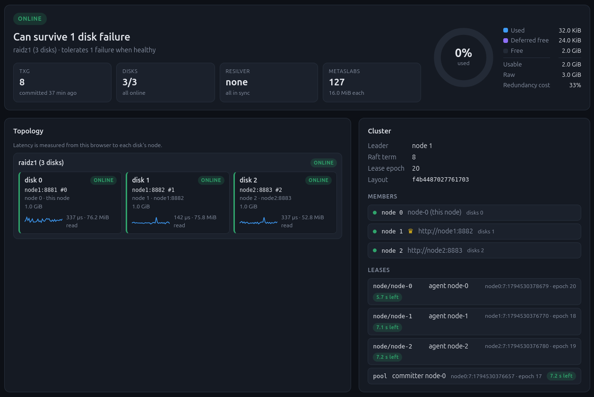

# RAIDish

an experimental distributed raidz/mirror filesystem



## Workspace Crates

RAIDish is organized as a Cargo workspace with library crates under `crates/`, the main `raidish` server/CLI binary at the repository root, and the browser dashboard in `web/`:

| Crate | Description |
|---|---|
| [`raidish-types`](crates/raidish-types/README.md) | Shared plain data: typed IDs, validated names, HTTP DTOs, VM models, and deterministic Raft cluster state (native + `wasm32`) |
| [`raidish-core`](crates/raidish-core/README.md) | Storage engine: local/WebSocket disks, RAID-Z/mirror/stripe vdevs, COW object trees, filesystems, volumes, B+tree KV, ZIL, snapshots, send/recv, scrub, and `fsck` (native + `wasm32`) |
| [`raidish-auth`](crates/raidish-auth/README.md) | Cluster PKI (ECDSA P-256 CA), rustls TLS config, stateless mTLS/`rdt1` token auth with Rocket guards, and shared TCP accept loop |
| [`raidish-cluster`](crates/raidish-cluster/README.md) | Embedded `openraft` Raft group, pool-derived membership, local JSON state persistence, and `HeldLease` client |
| [`raidish-committer`](crates/raidish-committer/README.md) | Single-writer `pool` committer failover loop, metaslab lending, `PoolAdmin` API, automatic resilvering, and `.events` activity log |
| [`raidish-block`](crates/raidish-block/README.md) | Dynamic NBD (`10809`) and NVMe/TCP (`4420`) volume exports, live-swappable `SwitchableIo`, and mTLS peer I/O (`10810`) |
| [`raidish-nfs`](crates/raidish-nfs/README.md) | NFSv3, NFSv4.1, and NFSv4.2 server (sessions, locks, pNFS flexfiles) over the pool filesystem |
| [`raidish-etcd`](crates/raidish-etcd/README.md) | etcd v3 (`3.5.17`) MVCC gRPC server (`KV`, `Watch`, `Lease`, status) backed by a B+tree dataset |
| [`raidish-services`](crates/raidish-services/README.md) | B+tree-backed S3 (`9000`) and SQS (`9324`), AWS SigV4, stateless `RDK1` keys, and multi-node S3/SQS/`etcd` routing frontend |
| [`raidish-vm`](crates/raidish-vm/README.md) | Libvirt domain XML validation, transient rendering, `virsh` lifecycle/migration, and the `.vms` store |
| [`raidish-csi`](crates/raidish-csi/README.md) | Kubernetes CSI (`csi.raidish.io`) gRPC driver for `ext4`/`xfs` and `ReadWriteMany` raw block volumes |

## Setup

step 1) run a server with our disks

```
mkdir disks/
fallocate -l 1G disks/disk1
fallocate -l 1G disks/disk2
fallocate -l 1G disks/disk3
fallocate -l 1G disks/disk4
fallocate -l 1G disks/disk5
cargo run -- --config example-config.yaml listen
```

`listen` serves the raw disks on port 8881 (`--port` to change).

step 2) format the pool from a client

```
// format disks with filesystem (sized from the disks' capacity)
cargo run -- --config remote-config.yaml format
// display blockmap info to the console
cargo run -- --config remote-config.yaml map
```

## Try it with Docker

`docker-compose.yml` runs a 3-node cluster: one 1 GiB disk per node in a
raidz1 pool (survives losing any one node), with the dashboard.

```
docker compose up --build
```

The dashboard runs in your browser and talks to every node by the name in the
pool config (`node0`, `node1`, `node2`), so add them to your hosts file once:

```
echo "127.0.0.1 node0 node1 node2" | sudo tee -a /etc/hosts
```

import `docker/pki/ca.pem` into your browser as a trusted CA (Firefox:
Settings → Certificates → View Certificates → Authorities → Import), open
https://node0:8881/ (any node's port works), and sign in with the read-only
token printed by `docker compose logs init`. `docker/pki/admin` is an admin
bundle you can use from the host (`tls: { dir: …/docker/pki/admin }`).

Run commands from any node. Inside the containers the default config
(`docker/client.yaml`) reaches every disk through its disk server:

```
docker compose exec node0 raidish cluster status
docker compose exec node0 raidish status
docker compose exec node0 raidish volume create vm1 104857600
docker compose exec node0 raidish volume list
```

Break things:

```
// lose a node: the pool goes degraded; if it was the committer, another node takes over
docker compose kill node2
// bring it back: the committer resilvers what it missed
docker compose start node2
// a hung node: its leases expire, another node takes over, and it steps down
// (fenced) once it wakes up
docker compose pause node0
docker compose unpause node0
// check the result
docker compose exec node0 raidish fsck
// start over with empty disks
docker compose down -v
```

`docker/node{0,1,2}.yaml` are the nodes' configs (each lists its own disk as
a local path). `DISK_SIZE=4G docker compose up` sizes new disks.
`docker build --build-arg RAIDISH_SKIP_UI=1 -t raidish .` builds the image
without the dashboard. The containers export volumes but don't attach kernel
block devices.

## Config

**The pool config is the cluster config.** Each remote disk URL names a
`listen` node, and local paths are this node. Give every node the same pool,
with its own disks as local paths (or as URLs pointing at itself):

```yaml
# on node A (10.0.0.1); B and C list their own disk locally instead
pool:
  raidz1:
    - /dev/disk/by-id/ata-A                  # this node
    - http://10.0.0.2:8881/api/v1/disks/1    # node B
    - http://10.0.0.3:8881/api/v1/disks/2    # node C
```

```
raidish --config node.yaml listen            # on each node
raidish --config client.yaml cluster status  # leader, members, leases
```

* Disks with the same `host:port` belong to one node, so a node with several
  disks is a single member.
* A node's id is the lowest pool position of its disks (A=0, B=1, C=2 above).
  Every node works out the same ids. Use one address form per node: listing
  the same box as an IP in one place and a hostname in another makes two
  members.
* A pool of only local disks is a cluster of one.
* Every node must list the disks in the same order. Raft traffic between nodes
  whose configs disagree is refused, and at startup each node asks its peers
  who they are and logs `CONFIG MISMATCH` if the answers don't fit.

## Pool layouts

The `pool` section of the config describes how the disks are combined:

```yaml
# 3 disks, raidz1 (2 data + 1 parity)
pool:
  raidz1: [disks/d1, disks/d2, disks/d3]

# 5 disks, raidz2 (3 data + 2 parity)
pool:
  raidz2: [disks/d1, disks/d2, disks/d3, disks/d4, disks/d5]

# any parity, up to 3
pool:
  raidz: { parity: 3, disks: [d1, d2, d3, d4, d5, d6] }

# n-way mirror
pool:
  mirror: [disks/d1, disks/d2, disks/d3]

# 4 disks on 4 nodes, two mirrors striped together (RAID10)
pool:
  stripe:
    - mirror: [http://node1:8881/api/v1/disks/0, http://node2:8881/api/v1/disks/0]
    - mirror: [http://node3:8881/api/v1/disks/0, http://node4:8881/api/v1/disks/0]
```

## Commands

```
// format the pool (--blocks N to override the size)
format
// load filesystem and display root file index
load
// write file to the file index
write path/to/file path/to/dest
// read file from the file index (written to ./output.png)
read path/to/file
// make a directory, list a directory, delete a file/volume
mkdir path
ls path
delete path
// show the object (dnode) at a path
inode path
// display the block map / metaslab usage / orphaned blocks (if any)
map
metaslab
orphaned
// create a copy-on-write volume (virtual block device)
block name size
// export a volume over NBD (port 10809) or NVMe/TCP (port 4420)
nbd name
nvme name
// disk health: online, label, degraded since which TXG
status
// verify every block (data and parity) and the labels, repair what's wrong
scrub [--dry-run]
// rebuild only what degraded disks missed while they were away
resilver
// check space maps against the tree (leaks, in-use blocks marked free, cross-links)
fsck [--repair] [--rebuild-spacemaps [--force]]
// copy everything still readable to a local directory
salvage path/to/dir
// lay a volume's records out contiguously (--check: only report)
defrag name [--batch N] [--check]
// volumes and where they run (through the committer when `listen` runs one)
volume create name size
volume delete name            // or name@snapshot
volume list
// snapshots and clones (see Snapshots and clones)
volume snapshot name@snapshot
volume snapshots name
volume clone name@snapshot newname
volume rollback name
// replication (see Send and receive): stream to stdout / from stdin
volume send name@snapshot [--from older] > stream
volume recv name [--force] < stream
volume set name [--nodes n1,n2] [--automount nbd|nvme|none] [--enable|--disable]
volume move name node
// serve this node's disks (port 8881), commit the pool, run the volumes placed here
listen [--port N] [--no-committer]
```

Every command takes `--rewind` or `--txg N` to open an older committed state (see below).

`load`, `read`, `ls`, `inode`, `map`, `metaslab`, `orphaned`, `status`, `scrub --dry-run`,
`fsck` (without `--repair`), `salvage` and `defrag --check` open the pool read-only, so they're safe to run against a pool that another process is serving.

## Recovery

`fsck` walks the object table and every object's tree, compares what they
reference with the space maps, then walks the directories from the root.
It reports *leaks* (allocated, referenced by nothing), *referenced-but-free*
blocks (live data the allocator could hand out again), *cross-links* (two
pointers to the same blocks), unreadable metadata, objects no directory
links to and entries for objects that don't exist (every dataset's
namespace is walked, starting from the dataset directory). `fsck --repair`
re-allocates live space and frees leaks.

`fsck --rebuild-spacemaps` throws the space maps away and derives them from
the tree.

The uberblock ring keeps the last 5 committed TXGs, and freed space isn't
reused for 4 TXGs, so each of them is a complete, intact tree. To go back:

* `--rewind` opens the newest TXG whose whole tree (metadata and data)
  verifies.
* `--txg N` opens exactly TXG `N`. `status` lists the TXGs you can rewind to.

A writable command commits the rewind. It rebuilds the space maps from the
chosen tree, which frees what the discarded TXGs wrote, and it commits with a
TXG newer than any in the ring, so the discarded TXGs are gone for good.

Read-only commands (`ls`, `read`, `salvage`, ...) only look at the older state.

`salvage dir` copies every file it can read into `dir`, and each volume as a
sparse `<name>.img`. Records that fail their checksum are zero-filled, and it
reports each damaged item with the byte ranges that were lost. If the newest
root directory is unreadable, it falls back to the newest TXG whose root still
reads.

### Placement and auto-mount

Each `listen` node also runs an *agent*. It keeps a `node/<name>` lease
(liveness) and runs the volumes placed on it:

```
raidish --config client.yaml volume create vm0 21474836480
raidish --config client.yaml volume set vm0 --nodes node-0,node-1 --automount nvme
raidish --config client.yaml volume list
raidish --config client.yaml volume move vm0 node-1
```

* A volume with `--automount` runs on the first live node in `--nodes` (any
  live node if the list is empty). It **stays** where it runs while that node
  is live: if node-0 dies it moves to node-1, and stays there when node-0 comes
  back. `volume move` moves it explicitly. `--disable` stops it everywhere.
* Where it runs, the agent exports it (NBD on 10809, NVMe/TCP on 4420, export
  name / NQN `nqn.2024-01.com.raidish:nvme:<name>`) and attaches the kernel
  device through the `hack/raidish-attach` root helper (see Testing).
  `GET /api/v1/agent/status` lists what a node runs and on which device.
* A node's name is `node-<id>`.

```yaml
automount:
  bind: 127.0.0.1        # where the exports listen and the initiator connects
  nbd_port: 10809
  nvme_port: 4420
  helper: /usr/local/sbin/raidish-attach   # `none`: export only, don't attach
```

## Files over HTTP

Every `listen` node serves the file API, so a client can use any node and
doesn't need to know which one commits the pool:

```
curl -T big.iso      http://node1:8882/api/v1/files/isos/big.iso   # create/replace (streamed)
curl                 http://node2:8883/api/v1/files/isos/big.iso   # read (streamed)
curl -r 0-1048575    http://node2:8883/api/v1/files/isos/big.iso   # read a range (206)
curl                 http://node0:8881/api/v1/dir/isos             # list (JSON)
curl -X PUT          http://node0:8881/api/v1/dir/isos             # mkdir
curl -X DELETE       http://node0:8881/api/v1/files/isos/big.iso   # delete (a dir must be empty)
curl                 http://node0:8881/api/v1/stat/isos/big.iso    # size, mode, owner, times (JSON)

# write at an offset (extends the file if need be), then optionally set its size
curl -X PATCH --data-binary @part.bin 'http://node1:8882/api/v1/files/vm1/disk.raw?offset=4096'
curl -X PATCH 'http://node1:8882/api/v1/files/vm1/disk.raw?size=1048576'    # truncate / extend
# rename or move (may replace a file, or an empty directory)
curl -X POST -H 'Content-Type: application/json' \
     -d '{"from": "isos/big.iso", "to": "archive/big.iso"}' http://node0:8881/api/v1/rename
# attributes (each optional)
curl -X PATCH -H 'Content-Type: application/json' \
     -d '{"mode": 420, "uid": 1000, "gid": 1000}' http://node0:8881/api/v1/attrs/archive/big.iso
```

* Uploads are written by the node that receives them, into metaslabs the
  committer lent it. Only the namespace change goes to the committer, and
  commits from different nodes share TXGs.
* An upload holds the file's `obj/<id>` lease. While it does, other changes to
  that file are refused (`409`). A file that changed after the upload started
  is also refused, not overwritten.
* A `PATCH` holds the file's `obj/<id>` lease too, writes only the records it
  touches (into this node's lent space), and is committed before it is
  answered. If the file was replaced or deleted meanwhile, its writes are
  dropped (`409`), never written over the new contents.
* Reads see every committed change (close-to-open): each request catches up
  with the newest committed root first.
* Uploads are capped at 64 GiB (the `upload` limit in Rocket's config).

## NFS

`listen` serves the pool over NFSv3, NFSv4.1 and NFSv4.2 when the config
has an `nfs` section:

```yaml
nfs:
  bind: 127.0.0.1   # the default; NFS has no authentication of its own here
  port: 2049        # NFS 3 and 4, MOUNT and the portmapper all on this port
```

```
mount -t nfs -o vers=4.2 127.0.0.1:/ /mnt/pool
mount -t nfs -o vers=3,proto=tcp,port=2049,mountport=2049,mountproto=tcp,nolock \
      127.0.0.1:/ /mnt/pool
```

* While the committer fails over (about 10 s), writes pause and resume.
* Every node is the same NFSv4 server to clients (one server owner, from
  the pool), so a client can spread one mount over connections to several
  nodes (session trunking). Mount through any node and let the client find
  the others, or mount each node's address and the client joins them:

  ```
  mount -t nfs -o vers=4.1,trunkdiscovery,max_connect=3 node1:/ /mnt/pool
  ```
* When a node of a trunked mount fails, Linux (6.17 here) keeps the dead
  connection in use: requests already sent on it wait for that node to
  come back, as with a single connection. Taking it offline on the client
  lets new requests go to the others right away:
  `echo offline > /sys/kernel/sunrpc/xprt-switches/switch-N/xprt-M-tcp/xprt_state`.
* NFSv4.2 adds `SEEK` (`lseek` `SEEK_DATA`/`SEEK_HOLE`, so sparse files copy
  as sparse files) and `DEALLOCATE` (`fallocate --punch-hole`: whole
  records in the range become holes and give their space back, the rest is
  zeroed). Both work by record (up to 120 KiB), so a hole starts at the
  first record wholly inside it. Preallocation (`ALLOCATE`, plain
  `fallocate`) is refused: copy-on-write space can't be set aside for later
  writes. Server-side copies and clones (`COPY`, `CLONE`) aren't there yet.
* pNFS with flexfiles layouts (NFSv4.1 and 4.2, on a cluster): every node's
  NFSv3 server is a data server for the same files by the same handles.

In the compose cluster every node serves NFS on the compose network. A
privileged client container can mount them:

```
docker compose --profile nfs-test up -d nfs-client
docker compose exec nfs-client sh -c 'mkdir -p /mnt/pool && mount -t nfs \
  -o vers=3,proto=tcp,port=2049,mountport=2049,mountproto=tcp,nolock node0:/ /mnt/pool'
```

### Certificates

`raidish cert` is the whole PKI, no openssl needed. Run it anywhere (the CA's
key never has to be on a node):

```
raidish cert init --dir pki                        # pki/ca.key + pki/ca.pem (the trust bundle)
raidish -c cluster.yaml cert issue-nodes --dir pki # pki/<host>/ for every host in the disk URLs
raidish cert issue admin --role admin --dir pki    # pki/admin/, for the command line
raidish cert issue nas --role node --san 10.0.0.5 --dir pki   # or one at a time
raidish cert status --dir pki                      # what's trusted and issued, and expiry
```

Each `pki/<name>/` is a bundle (`ca.pem`, `cert.pem`, `key.pem`) to copy to
that machine (`scp -r pki/node1 node1:/etc/raidish/tls`). Then in its config:

```yaml
tls:
  dir: /etc/raidish/tls      # or ca: / cert: / key: paths
pool:
  raidz1:
    - /data/disk
    - https://node1:8882/api/v1/disks/1     # https:// once tls is on
    - https://node2:8883/api/v1/disks/2
```

Node certificates name the host in the URLs (plus `localhost` and
`127.0.0.1`), so URLs must use the names (or `--san` addresses) the certs
were issued for. Certificates don't expire unless you pass `--days`; a node
warns at startup when its own is within 30 days.

### Tokens (the dashboard, scripts)

```
raidish token create alice                     # readonly, never expires
raidish token create ci --role admin --expires 90d
raidish token inspect <token>                  # who, role, expiry, and whether it's valid here
```

A token is signed by your admin certificate (from your config's `tls:`), and
every node checks it against its own CA bundle, so there's no user database.
Paste it into the dashboard's sign-in page, or send it as
`Authorization: Bearer <token>`.

### Rotation

Restart nodes one at a time.

**A certificate** (lost key, new SAN, expiry): `cert issue <name> … --force`,
copy the bundle, restart that node. Old and new are signed by the same CA,
so nobody else changes.

## Virtual Block Devices

```
// create a 20 GiB volume
cargo run -- --config remote-config.yaml block vm0 21474836480
```

## NBD

step 1) run the NBD server for a volume

```
cargo run -- --config remote-config.yaml block vdisk0 104857600
cargo run -- --config remote-config.yaml nbd vdisk0
```

step 2) use with nbd

```
// connect /dev/nbd0 to our nbd server
sudo nbd-client localhost 10809 /dev/nbd0

// interact with block device
sudo mkfs.ext4 /dev/nbd0
sudo file -s /dev/nbd0
sudo blkid /dev/nbd0
sudo mount -o discard /dev/nbd0 path/to/mount
sudo umount path/to/mount

// disconnect /dev/nbd0 interface
sudo nbd-client -d /dev/nbd0
```

### Running a VM

QEMU has its own NBD client:

```
// write a disk image onto the volume
qemu-img convert -n -f qcow2 -O raw debian-12-nocloud-amd64.qcow2 nbd://127.0.0.1:10809
// boot it
qemu-system-x86_64 -enable-kvm -cpu host -m 2048 -smp 2 \
  -drive file=nbd://127.0.0.1:10809,format=raw,if=virtio,cache=none,discard=unmap \
  -nic user,model=virtio-net-pci -nographic
```

### VMs managed by the cluster (libvirt)

With a `vm:` section in the config, `listen` runs VMs whose disks are
volumes, through libvirt on whichever node holds their disks. `vm: {}` is
enough: every key is an override of a default, live migration included.

```yaml
vm:
  uri: qemu:///system        # default
  shutdown_timeout_s: 60     # then it's destroyed
  # Where qemu reaches this node's NBD exports (default: the automount bind
  # address and port), and where VNC consoles listen and this node connects
  # to them (default 127.0.0.1). For a libvirt on another network stack,
  # e.g. raidish in a container (see "VMs in the compose cluster").
  # nbd_host: 127.0.0.1
  # nbd_port: 10809
  # console_listen: 127.0.0.1
  # Live migration to this node, always over TLS: how other nodes' libvirt
  # reaches this one's (default qemu+tls://<host>/system, <host> as the
  # other nodes' configs name this node), where qemu's migration stream
  # connects (default: that host), and how long a migration from here may
  # take before it's aborted.
  # migrate_uri: qemu+tls://node1/system
  # migrate_host: 10.0.0.2
  # migrate_timeout_s: 300
```

A VM is a libvirt domain XML kept in the pool's `.vms` system dataset. It's
stored, changed and deleted only through the VM API (`raidish vm`, the
dashboard, `PUT /api/v1/vms/<name>`), not the file manager or NFS. A disk
that is a raidish volume says so:

```xml
<disk type='file' device='disk'>
  <source file='raidish:vm1'/>          <!-- or protocol='nbd' name='vm1' -->
  <target dev='vda' bus='virtio'/>
</disk>
```

```
virsh dumpxml myvm > myvm.xml        # edit its disk sources to raidish:VOLUME
raidish vm import myvm myvm.xml      # --replace to change an existing one
raidish vm show myvm                 # its stored XML
raidish vm delete myvm               # its volumes stay
virsh undefine myvm                  # raidish runs it as a transient domain
raidish vm start myvm
raidish vm list
raidish vm move myvm node-2          # live if both nodes can, else cold
raidish vm restart|reboot|reset|stop|kill myvm
```

The dashboard's **VMs** tab does the same, with a VNC console.

How it works:

* Nothing is kept in `/etc/libvirt` on any host. The node that should run a
  VM renders its XML: raidish disks point at that node's own NBD export
  (qemu is the NBD client, no kernel device), the console becomes VNC on
  127.0.0.1, and raidish's metadata is added. It starts it with `virsh create`,
  so libvirt forgets it once it stops.
* The **anchor** volume (the first raidish disk) places the VM: its
  `nodes` / `move_to` / enabled settings, and its `ds/` lease. The VM's
  other disks follow the anchor. `vm move` is a move of the anchor. A VM's
  volumes are exported over NBD wherever they run, whatever their own
  `automount` says.
* Whether a VM *should* run is the one thing stored: a flag in the cluster
  state (`vm start` / `vm stop`). Whether it *does* run is never stored:
  `vm list` and the dashboard ask libvirt on the anchor's node each time.
* If a node dies, the anchor's lease runs out and another node takes the
  volumes and starts the VM (no fail-back). If a node loses its lease
  (partitioned), it destroys its VMs at once: their writes are already
  fenced. A domain still running from an earlier raidish process (raidish
  was killed) is destroyed when raidish comes back, because its NBD
  connections go nowhere.
* A node acts only on the domains it started: raidish stamps each with its
  pool's GUID and the node's name. Whatever else shares its libvirt (another
  node, another cluster's VMs, domains started by raidish before the stamp)
  is left alone.
* A VM that should run is started again if it stops, including when the
  guest shuts itself down. Use `vm stop` to turn one off.
* XML changes apply on the next start. A change names the change number it
  was made from (the dashboard does), so an edit of an older definition is
  refused rather than undoing someone else's. `vm restart` shuts it down (destroyed
  after the timeout) and starts it from the current XML. `vm list` shows
  `restart pending` until then.

**On every host:** libvirt, and the `listen` user in the `libvirt` group.
Every network or bridge that the XML names must exist on each host. Disks
are given to qemu as `raw`, so convert images with `qemu-img convert -O raw`.
The VNC console listens on 127.0.0.1 (`console_listen`) without a password.
Any local user on that host can reach it; the dashboard reaches it through 
the node (`/api/v1/vms/<name>/console`, admin role).

**Live migration.** `vm move` migrates a running VM live when it can: the
VM's volumes are attached to both nodes, the target exports them proxied
to the source, `virsh migrate --live --p2p --tls` moves the guest. If it 
can't, or the migration fails, the move is cold: shut down here, started 
there.

## NVMe/TCP

There's no discovery controller, so connect to the subsystem directly.

step 1) run the NVMe/TCP target for a volume

```
cargo run -- --config remote-config.yaml block vdisk0 1073741824
cargo run -- --config remote-config.yaml nvme vdisk0
```

step 2) connect with the kernel initiator (needs `nvme-cli`)

```
sudo modprobe nvme-tcp
sudo nvme connect -t tcp -a 127.0.0.1 -s 4420 -n nqn.2024-01.com.raidish:nvme:vdisk0

// find the device: the model is "RAIDISH NVMe-TCP Volume"
sudo nvme list

// disconnect
sudo nvme disconnect -n nqn.2024-01.com.raidish:nvme:vdisk0
```

NVMe device names (`/dev/nvmeXnY`) are assigned dynamically. If your machine has
NVMe drives of its own, check `nvme list` before running `mkfs` on anything.

Set `RAIDISH_NVME_TRACE=1` to log every command the target handles.

## Kubernetes volumes (CSI)

`raidish csi` is a CSI driver (`csi.raidish.io`): a PersistentVolumeClaim
becomes a raidish volume, attached over NVMe/TCP on whichever node its pod
runs, formatted (ext4 or xfs) and mounted into the pod. Raw block volumes
(`volumeMode: Block`) work too.

It runs as root on every node, next to `listen`, with a client config (an
admin certificate) and the node's cluster name:

```
raidish -c /root/.raidish.yaml csi --node node-0
# serves /var/lib/kubelet/plugins/csi.raidish.io/csi.sock
```

It's a thin layer over placement (see Placement and auto-mount):

* CreateVolume / DeleteVolume: `volume create` / `volume delete` (the PV's
  volume handle is the volume's name). A new volume runs nowhere.
* ControllerPublish to a node: `nodes: [that node]`, `automount: nvme`,
  enabled. That node's agent takes the volume's `ds/` lease, exports it and
  attaches the kernel device (so the node needs the attach helper and
  `nvme-cli`, and `automount.helper` must not be `none`). With only that
  node listed, the volume never fails over to a node its pod isn't on.
  ControllerUnpublish disables it and waits for the lease to be let go.
* NodeStage waits (up to 90 s) for the local agent to report the device,
  formats it if blank, `e2fsck -p`s an existing ext4, and mounts it at the
  staging path; NodePublish bind-mounts it into the pod.

Kubernetes' attach/detach controller won't attach a volume to a second node
until it's detached from the first, and the `ds/` lease would refuse a
second writer anyway. A failed attach is retried by the agent every 10 s.
No snapshots, clones, expansion or capacity reporting yet.

## Testing

```
cargo test
// slow crash-consistency tests (crash at ~80 points of a workload, ~2 min)
cargo test -- --ignored
```

`hack/raidish-nbd-test` and `hack/raidish-nvme-test` wrap the few privileged steps
(connect, mkfs, mount, umount, fsck, fstrim) for end-to-end tests against the kernel
initiators. They only touch `/dev/nbd15` and the raidish NVMe namespace, and mount with
`nosuid,nodev,noexec`. Install them root-owned with a single sudo rule each:

```
sudo install -o root -g root -m 0755 hack/raidish-nbd-test /usr/local/sbin/
echo "$(whoami) ALL=(root) NOPASSWD: /usr/local/sbin/raidish-nbd-test" | sudo tee /etc/sudoers.d/raidish-nbd-test
sudo chmod 0440 /etc/sudoers.d/raidish-nbd-test
```

(The same for `raidish-nvme-test`.)

`hack/raidish-attach` is the narrow root helper the `listen` agent calls (via `sudo -n`) to
attach and detach kernel block devices for volumes: `nvme-attach|nbd-attach <volume> <addr> <port>`,
`nvme-detach|nbd-detach <volume>`, `list`. It accepts no device paths, validates the volume name
(`^[A-Za-z0-9._-]{1,64}$`), only connects to allowlisted address/port pairs (default `127.0.0.1`
with 4420 for NVMe and 10809 for NBD; widen only via a root-owned `/etc/raidish/attach.conf`, see
the script header), only touches NVMe namespaces whose model starts with `RAIDISH`, and detaches
NBD devices only from its own records under `/run/raidish/`. `RAIDISH_ATTACH_DRY_RUN=1` prints the
commands without running them.

```
sudo install -o root -g root -m 0755 hack/raidish-attach /usr/local/sbin/
echo "$(whoami) ALL=(root) NOPASSWD: /usr/local/sbin/raidish-attach" | sudo tee /etc/sudoers.d/raidish-attach
sudo chmod 0440 /etc/sudoers.d/raidish-attach
```

## Send and receive

`volume send` writes a snapshot to stdout as a stream, and `volume recv`
makes it a snapshot of a volume in another pool (or the same one):

```bash
raidish volume send vm1@s1 | ssh backup raidish volume recv vm1
raidish volume send vm1@s2 --from s1 | ssh backup raidish volume recv vm1
```

The stream format is versioned (`RAIDSEND`, version 1). Streams can't be
resumed: an interrupted one is sent again from the start.

## Services: etcd, S3, SQS

A pool can also hold **service datasets**, each a B+tree with its own intent
log, run by one node at a time (under its `ds/<name>` lease, like a volume)
and reachable from every node:

| format  | speaks                         | one dataset is | port              | clients authenticate with |
|---------|--------------------------------|----------------|-------------------|---------------------------|
| `etcd`  | etcd v3 gRPC (KV, Watch, Lease, Maintenance, Cluster), TLS | a keyspace | its own (`--port`) | a client certificate |
| `s3`    | S3 REST over HTTPS, SigV4      | a bucket       | `s3_port` (9000)  | an access key from a token |
| `queue` | SQS (AWS JSON protocol) over HTTPS, SigV4 | a queue | `sqs_port` (9324) | an access key from a token |

Services need `tls:` (a node with `services:` and no TLS refuses to
start). Every node listens on every service port. A request that reaches a
node not running the dataset is forwarded, over TLS, to the node that is, 
so clients can use any node, or all of them. When the node running
a dataset goes away, another one takes it over once its lease expires
(about 10 s), like a placed volume. Writes are acknowledged once they're in
the intent log (durable), and reads only ever see durable writes.

```yaml
services:
  advertise: node0        # how the other nodes reach this one (default: hostname)
  # bind: 0.0.0.0  s3_port: 9000  sqs_port: 9324  region: us-east-1
  # s3_domain: s3.example  # also <bucket>.s3.example (virtual-hosted style)
```

```
raidish dataset create cfg --format etcd --port 2379
raidish dataset create photos --format s3
raidish dataset create jobs --format queue
raidish dataset set photos --nodes node-2,node-0   # where it may run, preferred first
raidish dataset list
raidish dataset delete jobs
```

```
etcdctl --endpoints=https://localhost:2379 --cacert docker/pki/ca.pem \
  --cert docker/pki/admin/cert.pem --key docker/pki/admin/key.pem put /a 1
eval "$(docker compose run --rm --entrypoint raidish -v ./docker/pki/admin:/etc/raidish/tls:ro init token s3-key | sed 's/^/export /')"
aws --endpoint-url https://localhost:9000 --ca-bundle docker/pki/ca.pem s3 cp big.iso s3://photos/
aws --endpoint-url https://localhost:9324 --ca-bundle docker/pki/ca.pem sqs send-message \
  --queue-url https://localhost:9324/000000000000/jobs --message-body hi
```

## Activity log

The cluster keeps a log of what happens in it, for admins: nodes joining,
leaving or going quiet, the committer moving, Raft leader changes, disks
going offline and coming back, resilvers, volumes, buckets, queues, etcd
datasets and VMs starting, stopping or failing (a failure that repeats is
logged once until it changes or clears), and the changes admins make
(volumes and datasets created, deleted or reconfigured, snapshots,
clones, rollbacks, VM start/stop/move requests), with who made them.
Individual reads and writes aren't logged.

The dashboard shows it in a footer on every page: collapsed, it shows the
newest event and a count of warnings and errors since you last looked;
expanded, a table you can filter by level or text. Scripts can read it from
any node:

```
GET /api/v1/events?limit=200          # the newest, oldest first
GET /api/v1/events?after=<seq>        # what's new since <seq>
GET /api/v1/events?before=<seq>       # older ones
```

## Limitations

* Without a running committer a pool has one writer (the `pool` lease holder).
  Writers on local disk paths (not served by `listen`) aren't fenced.
* A killed writer's lease takes up to 10 s to expire before another writer (or
  node, for a placed volume) can start.
* Authentication needs `tls:` (see [Security](#security)); without it the
  HTTP/websocket ports are open. Certificates and `auth.revoked` are read at
  startup, so changes need a (rolling) restart. NBD and NVMe/TCP exports are
  unauthenticated.
* An intent log's blocks aren't checked by scrub or rewritten by resilver:
  replay rebuilds blocks a disk missed from parity (up to the parity level),
  so a log is as safe as the pool's redundancy, minus whatever has failed
  since it was written.
* A standalone pool (no committer) that crashes mid-upload leaks the records
  written so far, if a commit ran in between (`fsck --repair` frees them).
* Snapshots are of volumes only. Files and directories can't be
  snapshotted (or sent) yet, there is no `promote` for clones, and rollback
  is to the newest snapshot only.
* Volumes are `block` datasets (not entries in `/`) and can't be renamed;
  `fs` is the only posix dataset. Deleting a directory that isn't empty is
  refused. There are no hard links or symlinks.
* Services: etcd datasets are one-member clusters (no MemberAdd or
  snapshot; etcd's own users and roles are reported disabled: access is by
  certificate). S3 has no versioning, ACLs, policies, lifecycle, object
  lock, tagging or SSE (those requests answer `NotImplemented`), and an
  access key reaches every bucket and queue its role allows (no per-bucket
  keys yet). SQS has no FIFO queues and doesn't speak the older query (XML)
  protocol; a stale receipt (one received again since) deletes nothing.
  `auth.revoked` is read at startup, like for tokens.
* Self-heal by checksum tries at most two bad disks per record, so raidz3 only
  gets its third parity shard's worth of protection from missing (offline)
  disks, not from silently corrupt ones. The same goes for mirrors of 4 or
  more disks: a record silently corrupt on 3 copies may not be healed from
  the 4th (it depends on which copies are bad). Such a read fails (the 
  checksum decides); it never returns bad data.
* The superblock and uberblocks live on the first stripe member (usually),
  so they are only as redundant as that member.

## TODO

* file-tree snapshots
* permissions
* NVMe/TCP: discovery, digests, host authentication
