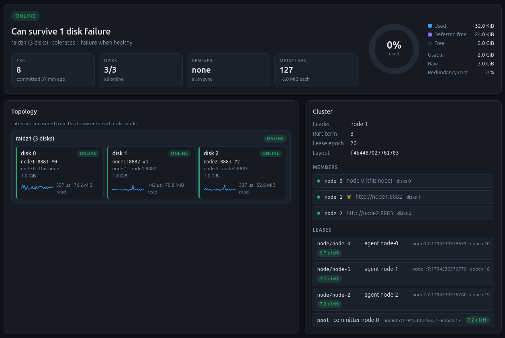

# RAIDish

a distributed raidz/mirror filesystem proof of concept



## Setup

step 1) run a server with our disks

```
mkdir disks/
fallocate -l 1G disks/disk1
fallocate -l 1G disks/disk2
fallocate -l 1G disks/disk3
fallocate -l 1G disks/disk4
fallocate -l 1G disks/disk5
cargo run -- --config example-config.yaml listen
```

`listen` serves the raw disks on port 8881 (`--port` to change).

step 2) format the pool from a client

```
// format disks with filesystem (sized from the disks' capacity)
cargo run -- --config remote-config.yaml format
// display blockmap info to the console
cargo run -- --config remote-config.yaml map
```

## Try it with Docker

`docker-compose.yml` runs a 3-node cluster: one 1 GiB disk per node in a
raidz1 pool (survives losing any one node), with the dashboard.

```
docker compose up --build
```

The first start formats the pool and creates a demo volume (the `init`
service). Each node publishes its port on 127.0.0.1 only (node0 8881, node1
8882, node2 8883), because the disk servers have no authentication.

The dashboard runs in your browser and talks to every node by the name in the
pool config (`node0`, `node1`, `node2`), so add them to your hosts file once:

```
echo "127.0.0.1 node0 node1 node2" | sudo tee -a /etc/hosts
```

and open http://node0:8881/ (any node's port works).

Run commands from any node. Inside the containers the default config
(`docker/client.yaml`) reaches every disk through its disk server:

```
docker compose exec node0 raidish cluster status
docker compose exec node0 raidish status
docker compose exec node0 raidish volume create vm1 104857600
docker compose exec node0 raidish volume list
```

Break things:

```
// lose a node: the pool goes degraded; if it was the committer, another node takes over
docker compose kill node2
// bring it back: the committer resilvers what it missed
docker compose start node2
// a hung node: its leases expire, another node takes over, and it steps down
// (fenced) once it wakes up
docker compose pause node0
docker compose unpause node0
// check the result
docker compose exec node0 raidish fsck
// start over with empty disks
docker compose down -v
```

`docker/node{0,1,2}.yaml` are the nodes' configs (each lists its own disk as
a local path). `DISK_SIZE=4G docker compose up` sizes new disks.
`docker build --build-arg RAIDISH_SKIP_UI=1 -t raidish .` builds the image
without the dashboard. The containers export volumes but don't attach kernel
block devices.

## Config

**The pool config is the cluster config.** Each remote disk URL names a
`listen` node, and local paths are this node. Give every node the same pool,
with its own disks as local paths (or as URLs pointing at itself):

```yaml
# on node A (10.0.0.1); B and C list their own disk locally instead
pool:
  raidz1:
    - /dev/disk/by-id/ata-A                  # this node
    - http://10.0.0.2:8881/api/v1/disks/1    # node B
    - http://10.0.0.3:8881/api/v1/disks/2    # node C
```

```
raidish --config node.yaml listen            # on each node
raidish --config client.yaml cluster status  # leader, members, leases
```

* Disks with the same `host:port` belong to one node, so a node with several
  disks is a single member.
* A node's id is the lowest pool position of its disks (A=0, B=1, C=2 above).
  Every node works out the same ids. Use one address form per node: listing
  the same box as an IP in one place and a hostname in another makes two
  members.
* A pool of only local disks is a cluster of one.
* Every node must list the disks in the same order. Raft traffic between nodes
  whose configs disagree is refused, and at startup each node asks its peers
  who they are and logs `CONFIG MISMATCH` if the answers don't fit.

## Pool layouts

The `pool` section of the config describes how the disks are combined:

```yaml
# 3 disks, raidz1 (2 data + 1 parity)
pool:
  raidz1: [disks/d1, disks/d2, disks/d3]

# 5 disks, raidz2 (3 data + 2 parity)
pool:
  raidz2: [disks/d1, disks/d2, disks/d3, disks/d4, disks/d5]

# any parity
pool:
  raidz: { parity: 3, disks: [d1, d2, d3, d4, d5, d6] }

# n-way mirror
pool:
  mirror: [disks/d1, disks/d2, disks/d3]

# 4 disks on 4 nodes, two mirrors striped together (RAID10)
pool:
  stripe:
    - mirror: [http://node1:8881/api/v1/disks/0, http://node2:8881/api/v1/disks/0]
    - mirror: [http://node3:8881/api/v1/disks/0, http://node4:8881/api/v1/disks/0]
```

## Commands

```
// format the pool (--blocks N to override the size)
format
// load filesystem and display root file index
load
// write file to the file index
write path/to/file path/to/dest
// read file from the file index (written to ./output.png)
read path/to/file
// make a directory, list a directory, delete a file/volume
mkdir path
ls path
delete path
// show a root entry's inode
inode name
// display the block map / metaslab usage / orphaned blocks (if any)
map
metaslab
orphaned
// create a copy-on-write volume (virtual block device)
block name size
// export a volume over NBD (port 10809) or NVMe/TCP (port 4420)
nbd name
nvme name
// disk health: online, label, degraded since which TXG
status
// verify every block (data and parity) and the labels, repair what's wrong
scrub [--dry-run]
// rebuild only what degraded disks missed while they were away
resilver
// check space maps against the tree (leaks, in-use blocks marked free, cross-links)
fsck [--repair] [--rebuild-spacemaps [--force]]
// copy everything still readable to a local directory
salvage path/to/dir
// lay a volume's records out contiguously (--check: only report)
defrag name [--batch N] [--check]
// volumes and where they run (through the committer when `listen` runs one)
volume create name size
volume delete name
volume list
volume set name [--nodes n1,n2] [--automount nbd|nvme|none] [--enable|--disable]
volume move name node
// serve this node's disks (port 8881), commit the pool, run the volumes placed here
listen [--port N] [--no-committer]
```

Every command takes `--rewind` or `--txg N` to open an older committed state (see below).

`load`, `read`, `ls`, `inode`, `map`, `metaslab`, `orphaned`, `status`, `scrub --dry-run`,
`fsck` (without `--repair`), `salvage` and `defrag --check` open the pool read-only, so they're safe to run against a pool that another process is serving.

## Recovery

`fsck` walks the whole tree and compares what it references with the space
maps. It reports *leaks* (allocated, referenced by nothing), *referenced-but-free*
blocks (live data the allocator could hand out again), *cross-links* (two
pointers to the same blocks) and unreadable metadata. `fsck --repair`
re-allocates live space and frees leaks.

`fsck --rebuild-spacemaps` throws the space maps away and derives them from
the tree.

The uberblock ring keeps the last 5 committed TXGs, and freed space isn't
reused for 4 TXGs, so each of them is a complete, intact tree. To go back:

* `--rewind` opens the newest TXG whose whole tree (metadata and data)
  verifies.
* `--txg N` opens exactly TXG `N`. `status` lists the TXGs you can rewind to.

A writable command commits the rewind. It rebuilds the space maps from the
chosen tree, which frees what the discarded TXGs wrote, and it commits with a
TXG newer than any in the ring, so the discarded TXGs are gone for good.

Read-only commands (`ls`, `read`, `salvage`, ...) only look at the older state.

`salvage dir` copies every file it can read into `dir`, and each volume as a
sparse `<name>.img`. Records that fail their checksum are zero-filled, and it
reports each damaged item with the byte ranges that were lost. If the newest
root directory is unreadable, it falls back to the newest TXG whose root still
reads.

### Placement and auto-mount

Each `listen` node also runs an *agent*. It keeps a `node/<name>` lease
(liveness) and runs the volumes placed on it:

```
raidish --config client.yaml volume create vm0 21474836480
raidish --config client.yaml volume set vm0 --nodes node-0,node-1 --automount nvme
raidish --config client.yaml volume list
raidish --config client.yaml volume move vm0 node-1
```

* A volume with `--automount` runs on the first live node in `--nodes` (any
  live node if the list is empty). It **stays** where it runs while that node
  is live: if node-0 dies it moves to node-1, and stays there when node-0 comes
  back. `volume move` moves it explicitly. `--disable` stops it everywhere.
* Where it runs, the agent exports it (NBD on 10809, NVMe/TCP on 4420, export
  name / NQN `nqn.2024-01.com.raidish:nvme:<name>`) and attaches the kernel
  device through the `hack/raidish-attach` root helper (see Testing).
  `GET /api/v1/agent/status` lists what a node runs and on which device.
* A node's name is `node-<id>`.

```yaml
automount:
  bind: 127.0.0.1        # where the exports listen and the initiator connects
  nbd_port: 10809
  nvme_port: 4420
  helper: /usr/local/sbin/raidish-attach   # `none`: export only, don't attach
```

## Virtual Block Devices

```
// create a 20 GiB volume
cargo run -- --config remote-config.yaml block vm0 21474836480
```

## NBD

step 1) run the NBD server for a volume

```
cargo run -- --config remote-config.yaml block vdisk0 104857600
cargo run -- --config remote-config.yaml nbd vdisk0
```

step 2) use with nbd

```
// connect /dev/nbd0 to our nbd server
sudo nbd-client localhost 10809 /dev/nbd0

// interact with block device
sudo mkfs.ext4 /dev/nbd0
sudo file -s /dev/nbd0
sudo blkid /dev/nbd0
sudo mount -o discard /dev/nbd0 path/to/mount
sudo umount path/to/mount

// disconnect /dev/nbd0 interface
sudo nbd-client -d /dev/nbd0
```

### Running a VM

QEMU has its own NBD client:

```
// write a disk image onto the volume
qemu-img convert -n -f qcow2 -O raw debian-12-nocloud-amd64.qcow2 nbd://127.0.0.1:10809
// boot it
qemu-system-x86_64 -enable-kvm -cpu host -m 2048 -smp 2 \
  -drive file=nbd://127.0.0.1:10809,format=raw,if=virtio,cache=none,discard=unmap \
  -nic user,model=virtio-net-pci -nographic
```

## NVMe/TCP

There's no discovery controller, so connect to the subsystem directly.

step 1) run the NVMe/TCP target for a volume

```
cargo run -- --config remote-config.yaml block vdisk0 1073741824
cargo run -- --config remote-config.yaml nvme vdisk0
```

step 2) connect with the kernel initiator (needs `nvme-cli`)

```
sudo modprobe nvme-tcp
sudo nvme connect -t tcp -a 127.0.0.1 -s 4420 -n nqn.2024-01.com.raidish:nvme:vdisk0

// find the device: the model is "RAIDISH NVMe-TCP Volume"
sudo nvme list

// disconnect
sudo nvme disconnect -n nqn.2024-01.com.raidish:nvme:vdisk0
```

NVMe device names (`/dev/nvmeXnY`) are assigned dynamically. If your machine has
NVMe drives of its own, check `nvme list` before running `mkfs` on anything.

Set `RAIDISH_NVME_TRACE=1` to log every command the target handles.

## Testing

```
cargo test
// slow crash-consistency tests (crash at ~80 points of a workload, ~2 min)
cargo test -- --ignored
```

`hack/raidish-nbd-test` and `hack/raidish-nvme-test` wrap the few privileged steps
(connect, mkfs, mount, umount, fsck, fstrim) for end-to-end tests against the kernel
initiators. They only touch `/dev/nbd15` and the raidish NVMe namespace, and mount with
`nosuid,nodev,noexec`. Install them root-owned with a single sudo rule each:

```
sudo install -o root -g root -m 0755 hack/raidish-nbd-test /usr/local/sbin/
echo "$(whoami) ALL=(root) NOPASSWD: /usr/local/sbin/raidish-nbd-test" | sudo tee /etc/sudoers.d/raidish-nbd-test
sudo chmod 0440 /etc/sudoers.d/raidish-nbd-test
```

(The same for `raidish-nvme-test`.)

`hack/raidish-attach` is the narrow root helper the `listen` agent calls (via `sudo -n`) to
attach and detach kernel block devices for volumes: `nvme-attach|nbd-attach <volume> <addr> <port>`,
`nvme-detach|nbd-detach <volume>`, `list`. It accepts no device paths, validates the volume name
(`^[A-Za-z0-9._-]{1,64}$`), only connects to allowlisted address/port pairs (default `127.0.0.1`
with 4420 for NVMe and 10809 for NBD; widen only via a root-owned `/etc/raidish/attach.conf`, see
the script header), only touches NVMe namespaces whose model starts with `RAIDISH`, and detaches
NBD devices only from its own records under `/run/raidish/`. `RAIDISH_ATTACH_DRY_RUN=1` prints the
commands without running them.

```
sudo install -o root -g root -m 0755 hack/raidish-attach /usr/local/sbin/
echo "$(whoami) ALL=(root) NOPASSWD: /usr/local/sbin/raidish-attach" | sudo tee /etc/sudoers.d/raidish-attach
sudo chmod 0440 /etc/sudoers.d/raidish-attach
```

## Limitations

* Without a running committer a pool has one writer (the `pool` lease holder).
  Writers on local disk paths (not served by `listen`) aren't fenced.
* Every volume commit is its own TXG at the committer (no batching across
  writers yet), and a writer's flush waits for the committer, however long a
  committer failover takes.
* Scrub/resilver repairs by the committer can't write into metaslabs lent to a
  writer (they're fenced); those are repaired once the metaslab comes back.
* A killed writer's lease takes up to 10 s to expire before another writer (or
  node, for a placed volume) can start.
* **No authentication** on the disk server's HTTP/websocket ports (or the dashboard).
* Every fsync costs a full TXG commit (~5 ms); there's no intent log yet.
* Volumes live in the root directory, and deleting a directory leaks its contents.
* Self-heal by checksum tries at most two bad disks per record, so raidz3 only
  gets its third parity shard's worth of protection from missing (offline)
  disks, not from silently corrupt ones.
* The superblock and uberblocks live on the first stripe member (usually),
  so they are only as redundant as that member.

## TODO

* batch volume commits from several writers into one TXG
* intent log (ZIL) for low-latency fsync
* snapshots and clones
* permissions
* NVMe/TCP: discovery, digests, host authentication
